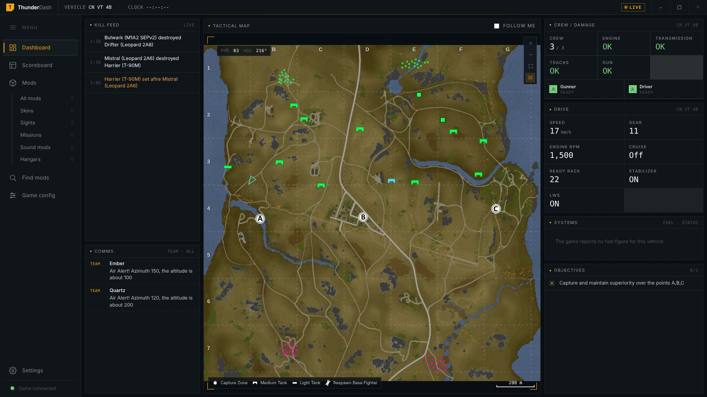
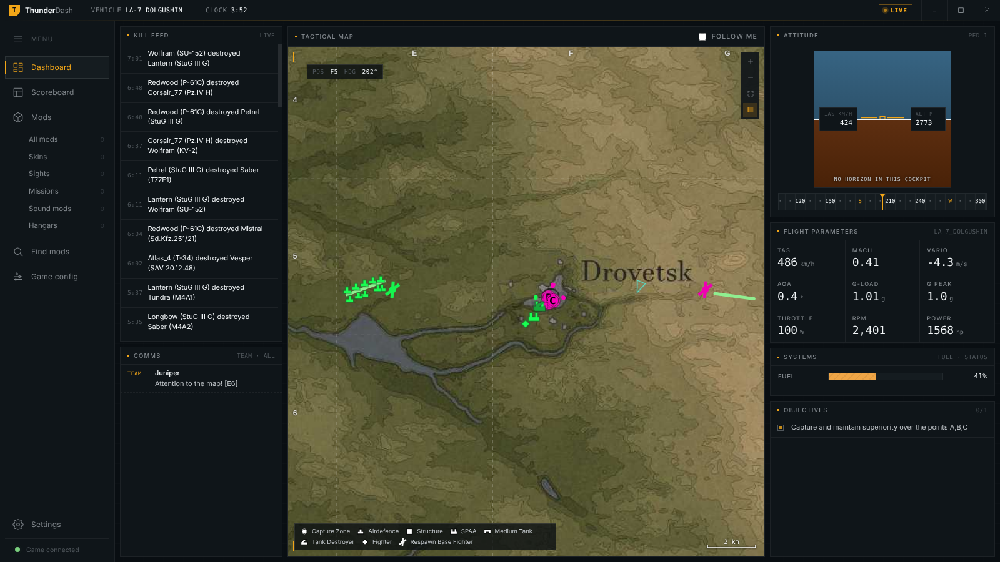
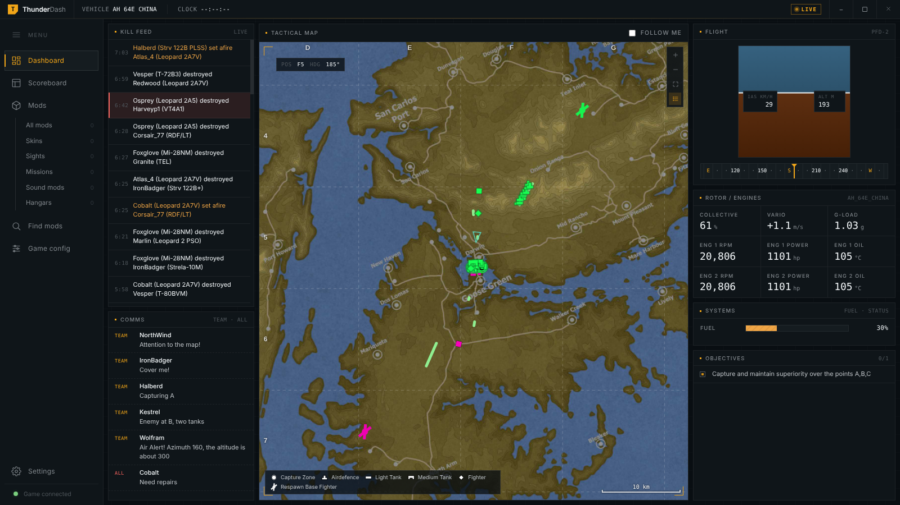
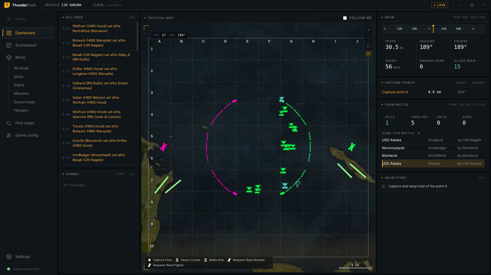
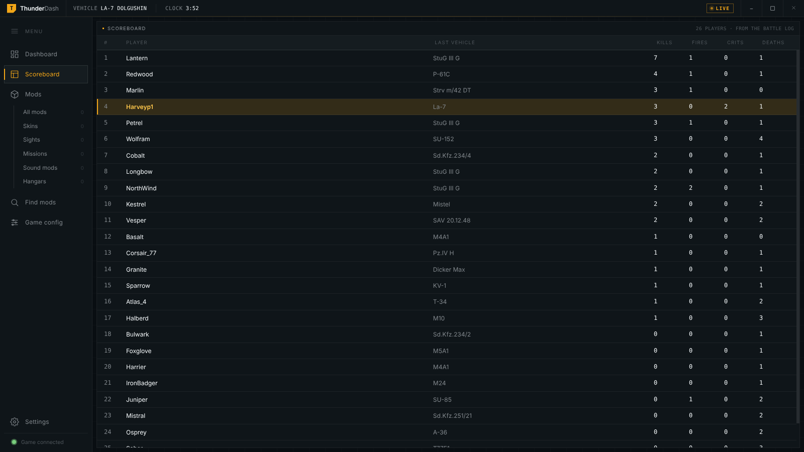
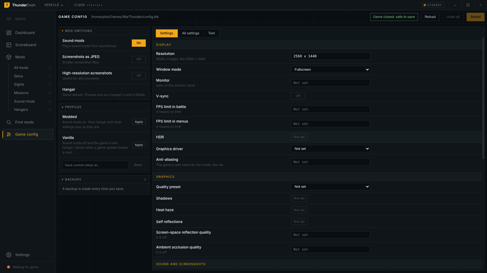

# ⚡ ThunderDash — Live Battle Dashboard for War Thunder

  

  <a href="https://github.com/Harveyp1/Thunderdash/releases/latest"><b>⬇️ DOWNLOAD THE LATEST VERSION</b></a>

---

## 📥 Download

Get the newest version from the [latest release](https://github.com/Harveyp1/Thunderdash/releases/latest):

- 🪟 **Windows 10 / 11:** `ThunderDash-Setup-x.y.z.exe`
- 🐧 **Linux (x86_64):** `ThunderDash-x.y.z-linux-x86_64.AppImage`

What changed in each version is written on the [Releases](https://github.com/Harveyp1/Thunderdash/releases) page.

---

## What is ThunderDash?

ThunderDash is a free desktop companion for War Thunder. It turns the game's live battle data into a clean, cockpit-style dashboard for your second monitor. Tanks, planes, helicopters and ships. Start a battle and it goes live on its own: no setup, no accounts.

---

**✨ Key Features**

🔧 **Crew & damage**
Crew, engine, transmission, tracks, gun, gear, RPM, cruise, stabilizer and ready rack at a glance.

✈️ **Flight panel**
Attitude indicator, TAS, Mach, AoA, G-load, throttle and thrust.

🚁 **Helicopters**
Rotor and engine readouts.

⚓ **Naval bridge**
Your speed in knots, heading and course, an on-fire and heavy-damage alert, the capture points, and your kills, fires set and ships sunk from the battle log.

🗺️ **Tactical map**
Big live map with grid, zoom, follow-me mode and your own markers. It shows the same units as the in-game map.

💬 **Kill feed, chat & scoreboard**
Live kill feed, team and all chat, objectives and a full scoreboard.

📦 **Mod manager**
Drop a mod zip or folder and ThunderDash works out what it is (skin, sight, mission, sound mod, hangar) and where it goes. Sort your library by nation and check your mods for updates. Nothing in a mod is ever run.

🔎 **Find mods**
Search WT Live from its own page inside the app: by mod type, tag and author, sorted by rating, date or downloads. Star your favourite authors and browse all their mods at once. Download shows what is inside a mod before anything is installed.

⚙️ **Game config**
Change your game settings without editing `config.blk` by hand. Save profiles (Modded, Vanilla, Squad night...), automatic backups, and it only saves while the game is closed.

---

**📸 Screenshots**

**Aircraft**: Flight panel with attitude, speed, Mach, G-load, fuel and the live map.

  

**Helicopter**: Rotor and engine readouts for both engines.

  

**Naval**: Helm, capture points and your own battle log.

  

**Scoreboard**: Kills, fires, crits and deaths for every player, built from the battle log.

  

**Game config**: Change game settings, switch profiles and keep automatic backups.

  

---

**🛠️ How to start**
1. Download and run the installer (Windows) or the AppImage (Linux, `chmod +x` first)
2. Launch War Thunder and join a battle
3. Open ThunderDash on your second monitor and watch it go live

Windows may show a SmartScreen warning the first time because the app is new. Click **More info** → **Run anyway**.

---

**⬆️ Updates**
ThunderDash checks this page's Releases for a new version and offers it at the top of the window. Nothing installs until you click, and every release is signed: the app deletes any download that isn't signed with the official key.

---

**🔒 Is it safe?**
The dashboard only reads the data War Thunder itself serves on your own PC at `http://127.0.0.1:8111` (the game's browser map). It does not read game memory and does not inject anything into the game. In Realistic battles it only knows about enemies your team has spotted, just like the in-game map.

**No aiming help.** ThunderDash shows what the game reports and nothing more. It does not calculate ranges, sight settings, lead or weapon ranges, and it does not measure distances to enemies or to points on the map.

---

**💻 Requirements**
Windows 10 / 11 or Linux x86_64 · War Thunder installed

**🔗 Find us on**
[WT Live](https://live.warthunder.com/) · [warthundermodmanager.com](http://www.warthundermodmanager.com/)

---

ThunderDash is a fan-made tool and is not affiliated with or endorsed by Gaijin Entertainment. War Thunder is a trademark of Gaijin Entertainment.
